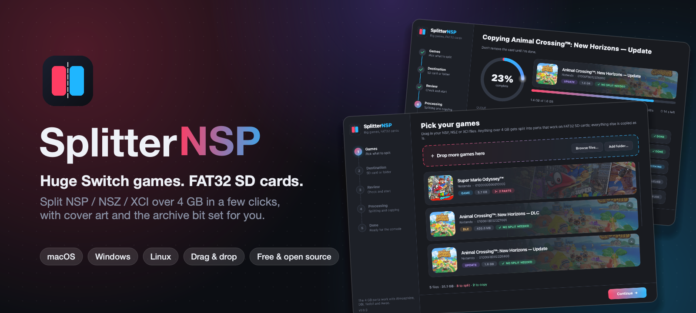
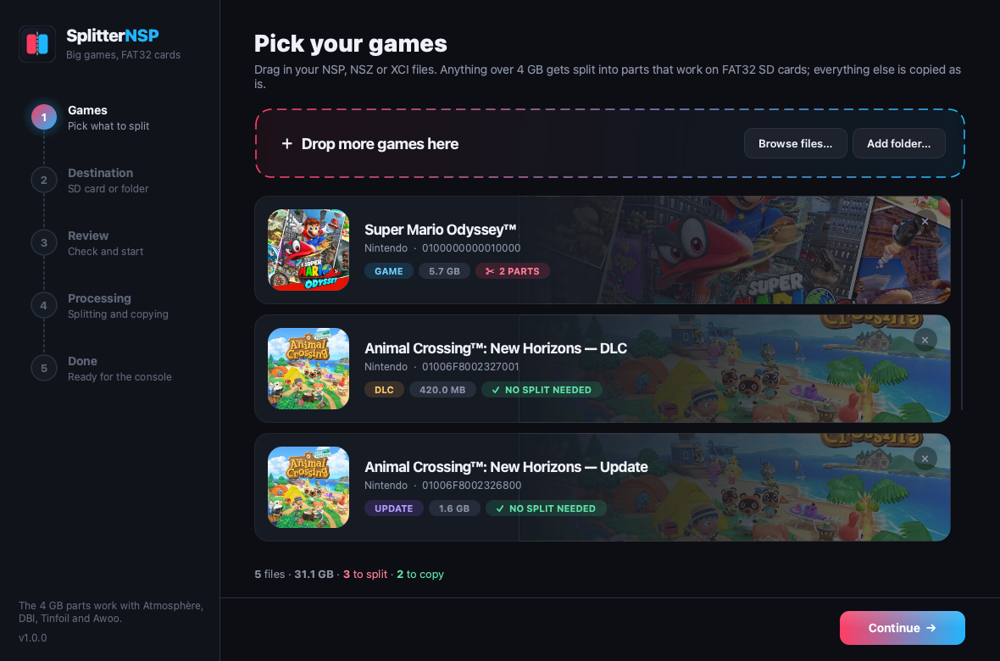
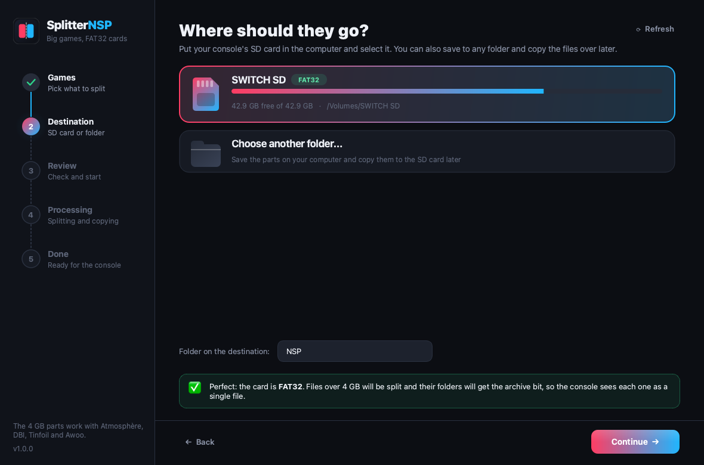
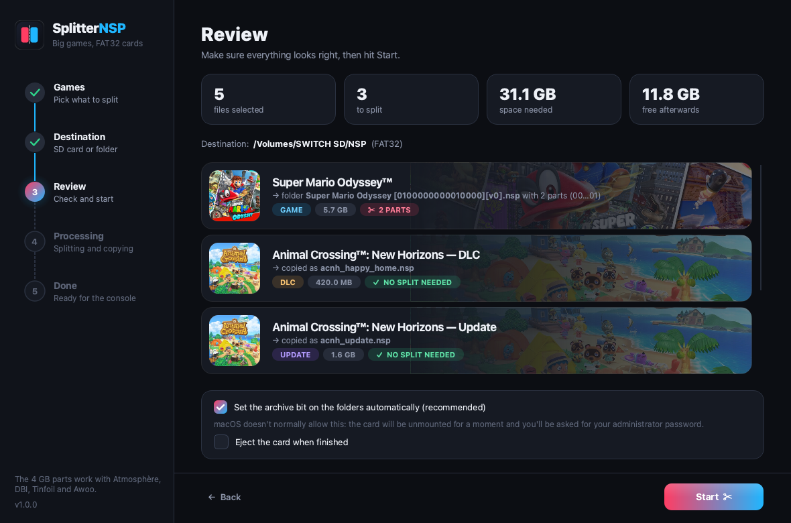
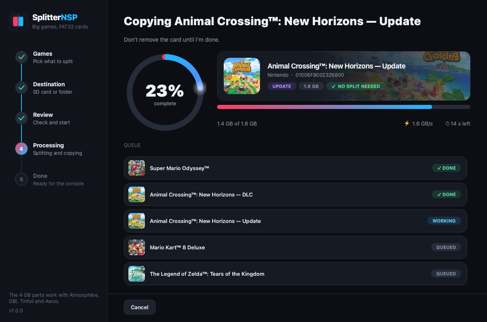
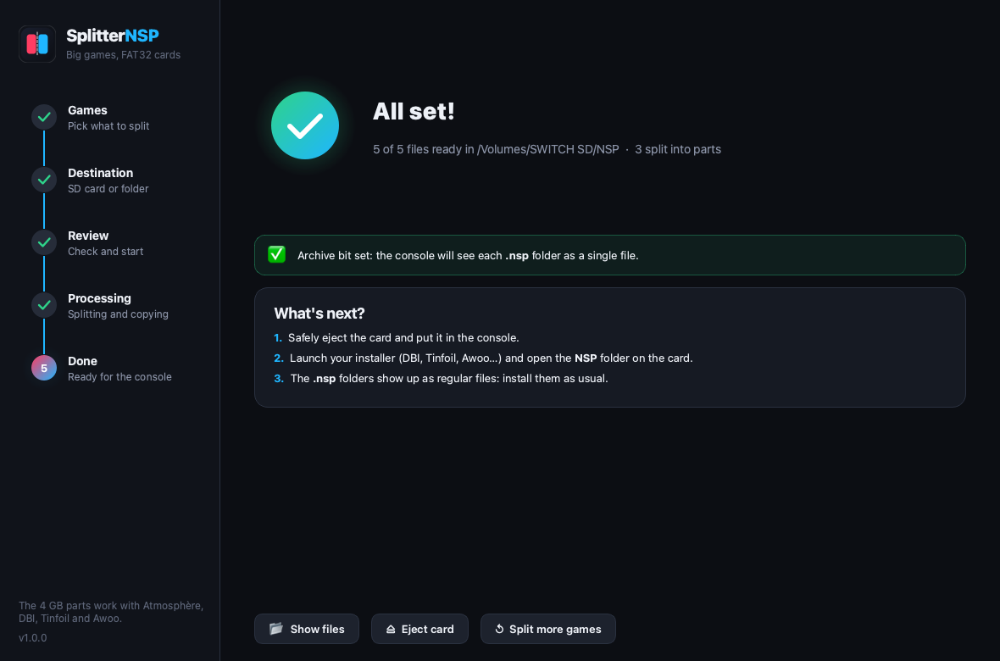

<div align="center">



# SplitterNSP

**Got a 16 GB game and a FAT32 SD card? Drag, drop, done.**

SplitterNSP splits Nintendo Switch **NSP / NSZ / XCI** files bigger than 4 GB into parts your FAT32 SD card accepts.<br>
A five-step wizard walks you through it, shows **cover art** for every game, and **sets the archive bit for you**.

[](https://github.com/Hentoo99/SplitterNSP/releases/latest)
[](#-download)
[](LICENSE)
[](https://github.com/Hentoo99/SplitterNSP/actions)

[**⬇️ Download**](#-download) · [**✨ Features**](#-features) · [**🧭 How it works**](#-how-it-works) · [**❓ FAQ**](#-faq)

</div>

---

## 🤔 The problem

FAT32 can't store a file bigger than **4 GB**, and many Switch games are much bigger.
The usual fix is to split them into numbered parts inside a folder and then set the folder's archive bit. That second step is easy to forget, and on a Mac it's surprisingly hard to do.

**SplitterNSP does both for you.**

## ✨ Features

|   |   |
|---|---|
| 🖱️ **Drag & drop** | Drop files, or a whole folder: it finds every NSP, NSZ and XCI inside. |
| 🖼️ **Cover art & real names** | Reads the Title ID straight from the file, then fetches the icon, banner, title and publisher. Updates and DLC show the base game's art. |
| 💾 **Finds your SD card** | Shows inserted cards right away, with file system (FAT32 / exFAT) and a space bar. |
| ✂️ **Splits only when needed** | Files over 4 GB become `Game.nsp/00, 01, 02…`. Smaller files are copied as they are. |
| 🅰️ **Archive bit, automatic** | Without it the console won't see the folder as a game. Windows uses `attrib`. On macOS SplitterNSP edits the FAT32 entry directly, with your admin password. |
| 🧹 **No macOS junk** | Removes the hidden `._*` files macOS leaves on FAT32 cards, which confuse homebrew installers. |
| 📊 **Live progress** | Progress ring, current part, speed and time remaining. You can cancel at any time. |
| ✅ **Safe** | Checks free space and warns before overwriting. A cancelled or failed copy leaves nothing half-written. |

## 🖼️ A quick tour

<table>
<tr>
<td width="50%"><br><b>1 · Pick your games.</b> Cover art and size for each file, plus whether it needs splitting.</td>
<td width="50%"><br><b>2 · Choose the SD card.</b> It's detected as soon as you insert it.</td>
</tr>
<tr>
<td><br><b>3 · Review.</b> Space needed, what gets split, options.</td>
<td><br><b>4 · Sit back.</b> Speed, ETA and the queue at a glance.</td>
</tr>
<tr>
<td colspan="2" align="center"><br><b>5 · All set.</b> Eject the card and install with DBI, Tinfoil or Awoo.</td>
</tr>
</table>

## ⬇️ Download

| Platform | File |
|---|---|
| 🍎 **macOS (Apple Silicon M1–M4)** | [SplitterNSP-macOS-AppleSilicon.dmg](https://github.com/Hentoo99/SplitterNSP/releases/latest/download/SplitterNSP-macOS-AppleSilicon.dmg) |
| 🍏 **macOS (Intel)** | [SplitterNSP-macOS-Intel.dmg](https://github.com/Hentoo99/SplitterNSP/releases/latest/download/SplitterNSP-macOS-Intel.dmg) |
| 🪟 **Windows 10/11 (64-bit)** | [SplitterNSP-Windows-x64.exe](https://github.com/Hentoo99/SplitterNSP/releases/latest/download/SplitterNSP-Windows-x64.exe) (portable, no install) |
| 🐧 **Linux (x64)** | [SplitterNSP-Linux-x64](https://github.com/Hentoo99/SplitterNSP/releases/latest/download/SplitterNSP-Linux-x64) |

> [!NOTE]
> The apps are not signed with a paid developer certificate, so the system will warn you the first time.
> - **macOS:** drag the app to *Applications*, then **right-click → Open → Open**. If macOS says the app "is damaged", run `xattr -dr com.apple.quarantine /Applications/SplitterNSP.app`.
> - **Windows:** on the SmartScreen prompt click **More info → Run anyway**.

## 🧭 How it works

```text
 Zelda TotK.nsp  (16.3 GB)                SD card (FAT32)
 ─────────────────────────      ✂️        └── NSP/
                                              ├── Zelda TotK.nsp/   ← folder with the archive bit
                                              │   ├── 00   4.29 GB
                                              │   ├── 01   4.29 GB
                                              │   ├── 02   4.29 GB
                                              │   └── 03   3.42 GB
                                              └── Small DLC.nsp     ← under 4 GB: copied as-is
```

- Each part is `0xFFFF0000` bytes (4 GiB − 64 KiB), the same layout as the classic `splitNSP.py`. It's understood by **Atmosphère, DBI, Tinfoil, Awoo** and friends.
- The **archive bit** (FAT attribute `0x20`) is what makes the console treat the folder as one file.
  - **Windows:** `attrib +A`
  - **Linux:** `fatattr +a`, if installed
  - **macOS:** there's no supported way to set this on a folder. SplitterNSP unmounts the card for a moment, flips just that one attribute byte in the FAT32 directory entry, and mounts the card again. The edit is checked: if the entry doesn't look exactly as expected, nothing is written.
- **Title ID** detection reads the `.tik` ticket name (or `.cnmt.xml`) from the NSP's PFS0 header. Nothing is decrypted and no keys are needed. If that fails, it falls back to `[0100…]` in the file name.
- **Cover art** comes from the public [nlib](https://api.nlib.cc) API and is cached locally.

## ❓ FAQ

<details>
<summary><b>My game doesn't show up on the console</b></summary>

The archive bit is probably missing, which happens if you copied the folders yourself. Boot **Hekate → Tools → Arch bit • RCM • Touch → Fix Archive bit**, or run SplitterNSP straight onto the SD card.
</details>

<details>
<summary><b>My card is exFAT. Do I need this?</b></summary>

No. exFAT handles big files natively. SplitterNSP tells you so, but can still split if you plan to move the files to a FAT32 card later.
</details>

<details>
<summary><b>Why does macOS ask for my password?</b></summary>

Setting the archive bit on macOS means writing one byte straight to the SD card's file system, and macOS requires admin rights for raw disk access. You can untick the option and use Hekate instead.
</details>

<details>
<summary><b>Can I use it without the GUI?</b></summary>

```bash
python -m splitter_nsp split "Game.nsp" /Volumes/SD/NSP   # split or copy one file
python -m splitter_nsp info *.nsp                        # show Title IDs
```
</details>

## 🛠️ Run from source

```bash
git clone https://github.com/Hentoo99/SplitterNSP.git
cd SplitterNSP
./run.command        # macOS (double-click works too) · run.sh on Linux · run.bat on Windows
```

The launchers create a virtual environment and install [PySide6](https://pypi.org/project/PySide6/) the first time. You need Python 3.9 or newer.

To build the standalone app yourself:

```bash
pip install -r requirements.txt -r requirements-build.txt
python scripts/build.py      # → dist/
```

Pushing a `v*` tag builds every platform on GitHub Actions and publishes a release.

<details>
<summary><b>Project layout</b></summary>

| Path | What's inside |
|---|---|
| `splitter_nsp/engine.py` | split/copy engine |
| `splitter_nsp/inspector.py` | PFS0 parsing, Title ID detection |
| `splitter_nsp/metadata.py` | names and cover art, with cache |
| `splitter_nsp/volumes.py` | SD card and file system detection (macOS / Windows / Linux) |
| `splitter_nsp/archive_bit.py` | archive bit, including a tiny FAT32 editor for macOS |
| `splitter_nsp/ui/` | the PySide6 wizard |
| `scripts/` | build and asset scripts |
</details>

## ⚖️ Disclaimer

SplitterNSP is a file utility. It doesn't download, decrypt or modify game content, and it isn't affiliated with or endorsed by Nintendo. Only use it with backups of games you own. Game names and artwork belong to their respective owners.

<div align="center">

Made with ✂️ and ☕ · MIT License · If it saved you some time, leave a ⭐

</div>
